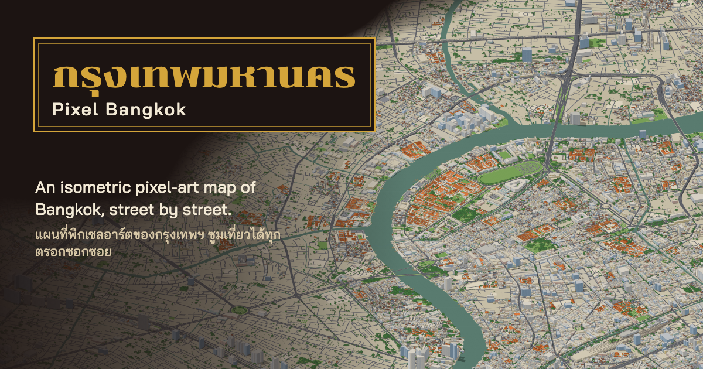

# Pixel Bangkok · กรุงเทพมหานคร

An interactive isometric pixel-art map of Bangkok you can pan, zoom and search, street by street.
Temples, canals, markets, the Chao Phraya, the BTS and MRT, in Thai and English.



## What you can do

- Explore a 20 × 20 km map of central Bangkok, from Chatuchak to Sathon and both banks of the river,
  plus closer maps of Inner Bangkok, the old town and Wat Arun.
- Follow numbered places in walking order, or search in Thai, English or by `lat, long`.
- Watch cars, tuk-tuks, boats and BTS trains move through the city.
- Switch between the plain drawing and an optional hand-painted (AI) look.
- Share a link to any place, for example `/?area=bangkok&place=wat-arun`.

## How it is made

Everything on the map is drawn by a program from open data, not by hand, so every building, road,
canal and tree is where it really is:

- **OpenStreetMap** for buildings, roads, water, railways and landmarks
- **Google Open Buildings** for building heights
- **Meta and WRI canopy maps** for trees
- **Wikidata** for place names and descriptions

A Python pipeline turns this data into one large isometric image, cuts it into map tiles, and a
Next.js site shows them. The optional AI layer is repainted locally and checked against the plain
drawing; anything that moved is thrown away.

## Run it locally

You need Node 24+, pnpm and [uv](https://docs.astral.sh/uv/).

```bash
pnpm install
pnpm pipeline all --area wat-arun    # build the small sample map (a few minutes)
pnpm dev                             # open http://localhost:3000
```

Larger areas are in `config/areas/`. Building `bangkok` takes about an hour and 6 GB of disk.

Tests and checks:

```bash
pnpm pipeline:test && pnpm test && pnpm lint && pnpm typecheck
pnpm build && pnpm test:e2e
```

## Project layout

| Folder | What is in it |
|---|---|
| `apps/web/` | The website (Next.js) |
| `pipeline/` | The map generator (Python) |
| `config/` | Map areas, colours and drawing settings |
| `data/curated/` | Hand-picked places and landmark heights |
| `deploy/` | Upload script and storage settings |

## Deploying

The site runs on Vercel and the map tiles live in Cloudflare R2, because the tiles are too many
for a web host (about 1.4 GB).

1. **Tiles:** create an R2 bucket with a custom domain, apply the CORS policy in
   `deploy/r2-cors.json` with your site's address, then upload:
   `deploy/upload-maps.sh <rclone-remote> <bucket>`.
2. **Site:** import this repository in Vercel with root directory `apps/web` and set:
   - `NEXT_PUBLIC_SITE_URL`: your site's address
   - `NEXT_PUBLIC_MAP_ASSETS_URL`: your bucket's address
   - `NEXT_PUBLIC_MAKER_NAME`: your name, shown in About
   - `NEXT_PUBLIC_REPO_URL`: this repository, linked in About (optional)
3. Submit `/sitemap.xml` in Google Search Console.

## Credits and licence

The code is under the [MIT licence](LICENSE). The map data keeps its own licences, which the site
credits on every map:

- Map data © [OpenStreetMap](https://www.openstreetmap.org/copyright) contributors, ODbL 1.0
- Building heights: Google Open Buildings 2.5D Temporal, CC BY 4.0
- Tree canopy: Meta and World Resources Institute, CC BY 4.0
- Descriptions: Wikidata, CC0

The optional AI layer uses Qwen-Image under the Qwen Research License, which allows
non-commercial use only.

Spot a mistake on the map? Use **Report** in the toolbar to fix it on OpenStreetMap; the fix
shows up the next time the map is built.
