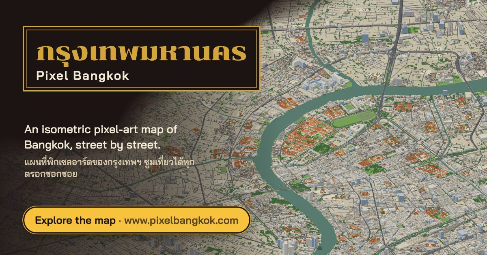

# Pixel Bangkok · กรุงเทพมหานคร

An interactive isometric pixel-art map of Bangkok you can pan, zoom and search, street by street.
Temples, canals, markets, the Chao Phraya, the BTS and MRT, in Thai and English.

**Live at [pixelbangkok.com](https://www.pixelbangkok.com)**

[](https://isometriccities.com/cities/bangkok/)



## What you can do

- Explore a 20 × 20 km map of central Bangkok, from Chatuchak to Sathon and both banks of the river,
  plus closer maps of Inner Bangkok, the old town and Wat Arun.
- Browse over 500 places in walking order, or filter them: places of worship, transit, landmarks,
  museums, parks, markets and neighbourhoods.
- Search in Thai or English, by station code (`E4`, `BL28`) or by `lat, long`. Stations show their
  line, so the BTS and Airport Rail Link stops at Phaya Thai are easy to tell apart.
- Watch cars, tuk-tuks, boats and trains on the elevated BTS and MRT lines move through the city.
- Share a link to any place, for example `/?area=bangkok&place=wat-arun`.

## How it is made

Everything on the map is drawn by a program from open data, not by hand, so every building, road,
canal and tree is where it really is:

- **OpenStreetMap** for buildings, roads, water, railways, stations and landmarks
- **Google Open Buildings** for building heights, with Wikidata and published figures for the tallest
  towers (the satellite heights stop near 100 m)
- **Meta and WRI canopy maps** for trees
- **Wikidata** for place names and descriptions

A Python pipeline turns this data into one large isometric image and cuts it into map tiles, and a
Next.js site shows them. No AI image model is involved, so nothing on the map is invented.

## Run it locally

You need Node 24+, pnpm and [uv](https://docs.astral.sh/uv/).

```bash
pnpm install
pnpm pipeline all --area wat-arun    # build the small sample map (a few minutes)
pnpm dev                             # open http://localhost:3000
```

Larger areas are in `config/areas/`. Building `bangkok` takes about an hour and 6 GB of disk.

Tests and checks:

```bash
pnpm pipeline:test && pnpm test && pnpm lint && pnpm typecheck
pnpm build && pnpm test:e2e
```

## Project layout

| Folder          | What is in it                           |
| --------------- | --------------------------------------- |
| `apps/web/`     | The website (Next.js)                   |
| `pipeline/`     | The map generator (Python)              |
| `config/`       | Map areas, colours and drawing settings |
| `data/curated/` | Hand-picked places and landmark heights |
| `deploy/`       | Upload script for the map tiles         |

## Credits and licence

The code is under the [MIT licence](LICENSE). The map data keeps its own licences, which the site
credits on every map:

- Map data © [OpenStreetMap](https://www.openstreetmap.org/copyright) contributors, ODbL 1.0
- Building heights: Google Open Buildings 2.5D Temporal, CC BY 4.0
- Tree canopy: Meta and World Resources Institute, CC BY 4.0
- Descriptions and some tower heights: Wikidata, CC0

Spot a mistake on the map? Use **Report** in the toolbar to fix it on OpenStreetMap; the fix
shows up the next time the map is built.
